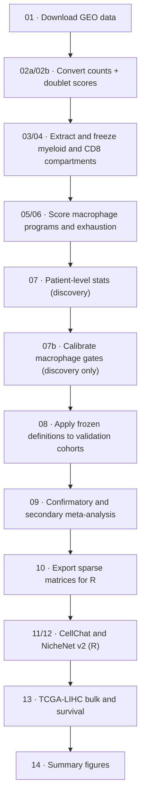

# Macrophage Programs and CD8⁺ T Cell Exhaustion in HCC

**A patient-level re-analysis of public single-cell RNA-seq data**


Do **FOLR2/C1Q-**, **SPP1/MMP-**, and **TREM2/GPNMB-** type macrophage programs track with CD8⁺ T cell exhaustion across patients with hepatocellular carcinoma (HCC)? This repository tests that question in public scRNA-seq data, using one discovery cohort, two held-out validation cohorts, and TCGA-LIHC bulk RNA-seq for supportive context.

---

## Summary

> **The discovery trends did not replicate.**
> In the discovery cohort (GSE149614, n = 8 patients), FOLR2_C1Q trended *negatively* and SPP1_MMP / TREM2_GPNMB trended *positively* with CD8⁺ exhaustion, but nothing survived multiple-testing correction. In held-out validation, every confirmatory test was null (Holm p = 1.00). Current public HCC scRNA-seq cohorts (n = 8, 9, 4 patients) appear underpowered and sensitive to sorting and cell-yield differences.
> The ligand–receptor (CellChat / NicheNet) and TCGA-LIHC bulk results are **hypothesis-generating context, not confirmation**.

| | |
| :--- | :--- |
| **Discovery** | GSE149614 (Lu et al. 2022), 10 patients, 71,915 cells |
| **Validation** | GSE156625 (Sharma et al. 2020), GSE140228 (Zhang et al. 2019) |
| **Bulk context** | TCGA-LIHC, 371 primary tumors |
| **Unit of replication** | The **patient**, not the cell |
| **Design rule** | All gene sets, thresholds, and cluster choices are frozen in discovery *before* any validation data are scored. Every post-hoc change is [logged below](#post-hoc-amendments-log). |
| **Languages** | Python (Scanpy, pyUCell, Harmony) for single-cell, stats, bulk, and plots; R (CellChat, nichenetr) for communication analysis |
| **Status** | Pipeline complete (scripts 01–14), last updated 2026-11-23 |

---

## Contents

- [Key findings](#key-findings)
- [Study design and datasets](#study-design-and-datasets)
- [Pipeline](#pipeline)
- [Quick start](#quick-start)
- [Results in detail](#results-in-detail)
  - [1. Discovery cohort](#1-discovery-cohort-gse149614)
  - [2. Validation and meta-analysis](#2-validation-cohorts-and-meta-analysis)
  - [3. CellChat and NicheNet](#3-cellchat-and-nichenet-ligandreceptor-analysis)
  - [4. TCGA-LIHC bulk and survival](#4-tcga-lihc-bulk-and-survival-supportive-context)
- [Methods and parameters](#methods-and-parameters)
- [Quality control](#quality-control-summary)
- [Post-hoc amendments log](#post-hoc-amendments-log)
- [Notes and decisions](#notes-and-decisions)
- [Repository layout](#repository-layout)
- [License](#license)
- [Citation and credits](#citation-and-credits)
- [Contact](#contact)

---

## Key findings

| # | Finding | Evidence |
| :-: | :--- | :--- |
| 1 | **Discovery is inconclusive.** Directions are consistent (FOLR2_C1Q ↓, SPP1_MMP ↑, TREM2_GPNMB ↑ with exhaustion) and robust to sensitivity checks, but no test passes Holm correction. | [Discovery](#1-discovery-cohort-gse149614) |
| 2 | **Validation failed to replicate.** Confirmatory validation-only pooling gives Holm p = 1.00 for all three programs; between-cohort heterogeneity is high (I² = 75.9% for FOLR2_C1Q, 77.4% for TREM2_GPNMB). | [Validation](#2-validation-cohorts-and-meta-analysis) |
| 3 | **The null is not a gating artifact.** A program-free macrophage selector (no FOLR2/SPP1/TREM2 genes) gives the same pattern. | [Sensitivity](#program-free-gate-sensitivity) |
| 4 | **Ligand–receptor signaling segregates by program across both cohorts**, e.g. SPP1→CD44 and MIF from SPP1_MMP macrophages, CXCL from FOLR2_C1Q macrophages. Seven NicheNet ligands (HLA-E, SELL, TNF, CD86, IL10, CALR, EBI3) replicate in the top 10 of both cohorts, with modest enrichment. | [CellChat/NicheNet](#3-cellchat-and-nichenet-ligandreceptor-analysis) |
| 5 | **TCGA-LIHC directions match discovery but conflict with GSE156625.** SPP1_MMP is associated with exhaustion and worse survival (stage-adjusted HR 1.349, Holm p = 0.00426), but bulk data cannot separate tumor-cell SPP1 from macrophage SPP1. | [TCGA](#4-tcga-lihc-bulk-and-survival-supportive-context) |

---

## Study design and datasets

| Dataset | Role | Cohort | Source |
| :--- | :--- | :--- | :--- |
| **GSE149614** | Discovery | 10 patients (HCC01–HCC10), 21 samples (10 tumor, 8 adjacent normal, 2 PVTT, 1 lymph node); 71,915 cells × 25,712 genes; unsorted; treatment-naive (per paper); 10x 3′ v2; raw integer counts | Lu et al. 2022, *Nat Commun* ([10.1038/s41467-022-32283-3](https://doi.org/10.1038/s41467-022-32283-3)) |
| **GSE156625** | Primary validation | 14 HCC patients; 73,589 cells (tumor 57,254, adjacent normal 16,335); CD45⁺:CD45⁻ mixed 1:1, so cell-type proportions are not comparable across datasets; `.X` is z-scored, so unscaled log-normalised values are taken from `.raw` (raw counts not recoverable); no author cell-type labels | Sharma et al. 2020, *Cell* ([10.1016/j.cell.2020.08.040](https://doi.org/10.1016/j.cell.2020.08.040)) |
| **GSE140228** | Supportive, partial validation | 10x droplet HCC subset: 4 donors, 46,897 CD45⁺ immune cells only; no SPP1⁺ macrophage cluster (SPP1 max mean 0.21), so it cannot evaluate SPP1_MMP; n = 4, so excluded from Fisher-z pooling | Zhang et al. 2019, *Cell* ([10.1016/j.cell.2019.10.003](https://doi.org/10.1016/j.cell.2019.10.003); PMID 31675496) |
| **TCGA-LIHC** | Supportive bulk and clinical context | 371 unique primary HCC tumors (UCSC Xena HiSeqV2, 20,530 genes); 347 with AJCC stage (I–IV); 365 with valid Overall Survival (130 deaths) | TCGA Research Network via UCSC Xena |

<details>
<summary><b>Excluded cohorts and why</b></summary>

- **GSE151530** (Ma et al. 2021, *J Hepatol*, PMID 34216724): 46 HCC and iCCA biopsies from 37 patients, including immunotherapy-treated and longitudinal pre/post-treatment samples.
- **GSE125449** (Ma et al. 2019, *Cancer Cell*, PMID 31588021): 19 HCC and iCCA biopsies from the same NCI cohort, co-cited under GSE151530.
- **GSE156337** is *not* an excluded cohort. It is the parent GEO SuperSeries of Sharma et al. 2020 (PMID 32976798), wrapping the included GSE156625 SubSeries and GSE156626.

</details>

<details>
<summary><b>GSE149614 patient table (clinical and cell counts)</b></summary>

Tumor = primary tumor.

| Patient | Stage | Virus | Other samples | Tumor cells | Tumor macrophage-like cells | Tumor strict-gate CD8 cells | In primary analysis |
| :--- | :--- | :--- | :--- | ---: | ---: | ---: | :--- |
| HCC01 | I | HBV | none | 3,368 | 1,083 | 101 | yes |
| HCC02 | I | HBV | none | 4,101 | 353 | 108 | yes |
| HCC03 | I | HCV | normal | 4,825 | 905 | 19 | no (n_CD8 < 20) |
| HCC04 | II | HCV | normal | 3,501 | 567 | 26 | yes |
| HCC05 | IIIA | none | normal | 3,353 | 529 | 68 | yes |
| HCC06 | IIIA | HBV | normal | 4,308 | 446 | 58 | yes |
| HCC07 | IIIB | none | normal, PVTT | 510 | 212 | 1 | no (n_CD8 < 20) |
| HCC08 | IIIB | none | normal, PVTT | 4,833 | 999 | 141 | yes |
| HCC09 | IV | HBV | normal | 2,816 | 320 | 64 | yes |
| HCC10 | IV | HBV | normal, lymph node | 2,799 | 605 | 105 | yes |

"none" is the literal string `None` in the metadata file (no HBV/HCV). pandas parses it as missing unless `keep_default_na=False` is set.

</details>

<details>
<summary><b>Validation clinical metadata</b> (<code>metadata/validation_clinical.csv</code>)</summary>

Transcribed from Supplementary Table 1 of Sharma et al. 2020 and Zhang et al. 2019.

- **GSE156625:** `patientno` (P1–P15, excluding P12 and healthy normal donor HN1) is the patient-level unit (`patient_id` in `.obs` indexes 49 tumor/normal sectors); `NormalvsTumor` (T/N) defines site. Table S1 provides sex, age, and HBV status (Pos/Neg); TNM/BCLC stage is not reported. Nine patients (P1, P2, P3, P5, P6, P7, P8, P9, P14) meet n_CD8 ≥ 20 and n_mac ≥ 20 in primary tumor. P4, P10, P11, P13, P15 are excluded for insufficient tumor cells.
- **GSE140228:** `.obs[Donor]` (D20171109, D20180108, D20180110, D20180116) maps 1-to-1 to Table S1 individual IDs (DSN09, DEJ08, DEJ10, DEJ16); `.obs[Tissue]` (Tumor, Normal, Ascites, Lymphnode, Blood) defines anatomical site. All four droplet HCC donors are male, Stage II (DSN09, DEJ10, DEJ16 HBV⁺; DEJ08 HBV⁻), and all four pass n_CD8 ≥ 20 and n_mac ≥ 20 in tumor.

</details>

---

## Pipeline



| Script | What it does | Tools | Key outputs |
| :--- | :--- | :--- | :--- |
| `01_download_geo_data.sh` | Download public GEO scRNA-seq datasets | curl/wget, gunzip | `data/raw/{GSE149614,GSE156625,GSE140228}/` |
| `02a_convert_GSE149614_counts.py` | Convert count table to sparse AnnData | pandas, SciPy, AnnData | `data/processed/GSE149614_all_raw.h5ad` |
| `02b_doublet_scores_GSE149614.py` | Per-sample doublet scores (annotation only) | Scrublet via Scanpy | `metadata/GSE149614_doublets.csv` |
| `03_extract_myeloid.py`, `04_extract_cd8.py` | Extract and freeze myeloid and CD8 compartments (shared code: `extract_common.py`; config: `metadata/datasets.yaml`) | Scanpy, Harmony (GSE149614 only), Leiden | `data/processed/<GSE>_{myeloid,cd8}_clean.h5ad`, `results/logs/<GSE>_{myeloid,cd8}.json` |
| `05_score_macrophage_programs.py` | Macrophage program scores (discovery) | pyUCell | `GSE149614_myeloid_scored.h5ad`, `macrophage_program_*_GSE149614.csv`, `macrophage_programs_frozen_GSE149614.yaml` |
| `06_score_exhaustion.py` | Exhaustion signature scores (discovery) | pyUCell | `GSE149614_cd8_scored.h5ad`, `exhaustion_scores_GSE149614.csv`, `signatures_frozen_GSE149614.yaml` |
| `07_patient_level_stats.py` | Patient-level statistics (discovery) | SciPy, NumPy | `stats_{primary,sensitivity}_GSE149614.csv`, `patient_level_table_primary_GSE149614.csv` |
| `07b_calibrate_macrophage_rule.py` | Calibrate and freeze primary and program-free macrophage-like gates (discovery only) | pyUCell, SciPy | `macrophage_rule_calibration{,_noprogram}_GSE149614.csv` |
| `08_score_validation_cohorts.py` | Apply frozen definitions and gates to validation cohorts | AnnData, pyUCell | `data/processed/{GSE156625,GSE140228}_{myeloid,cd8}_scored.h5ad` |
| `09_validation_and_pooled_stats.py` | Validation patient-level stats; confirmatory vs. secondary pooling; sensitivity | SciPy, NumPy | `stats_{primary,sensitivity}_{GSE156625,GSE140228}.csv`, `stats_pooled_{primary,sensitivity}.csv` |
| `10_export_for_r_communication.py` | Export sparse log(1+x) matrices and cell states for R | AnnData, SciPy | `data/processed/r_export/{GSE149614,GSE156625}/` |
| `11_run_cellchat.R` | Macrophage → CD8 communication inference | R, CellChat | `cellchat_{mac_to_cd8,pathways_mac_to_cd8}_*.csv` |
| `12_run_nichenet.R` | NicheNet v2 ligand prioritization (frozen V3 exhaustion; DEG sensitivity) | R, nichenetr | `nichenet_*_{GSE149614,GSE156625}.csv` |
| `13_tcga_lihc_bulk_validation.py` | TCGA-LIHC bulk and survival (auto-download; includes Treg sensitivity) | pandas, SciPy, Matplotlib | `data/raw/TCGA_LIHC/`, `tcga_lihc_*.csv`, `figures/tcga_lihc_validation.pdf` |
| `14_make_summary_figures.py` | Publication summary figures | Matplotlib, pandas | `figures/fig1_…`, `fig2_…`, `fig3_…` (`.pdf` and `.png`) |

Tables are written to `results/tables/` unless stated otherwise.

---

## Quick start

### 1. Set up the environment

Python and R dependencies live in a single Conda/Micromamba environment (`environment.yml`, env name `bioinfo`, run on Ubuntu Linux). R packages used by scripts 11 and 12 are logged in `r_packages.csv`.

```bash
# Create and activate the unified Python + R environment
conda env create -f environment.yml
conda activate bioinfo

# Ensure Harmony and Leiden/igraph backends are installed (needed by scripts 03 and 04)
pip install harmonypy==2.1.0 igraph==1.0.0 leidenalg==0.12.0

# Install CellChat and NicheNet v2 from GitHub inside the activated environment
Rscript -e 'remotes::install_github("sqjin/CellChat"); remotes::install_github("saeyslab/nichenetr")'
```

### 2. Download the NicheNet reference files

Download these three NicheNet v2 human reference files from the NicheNet v2 Zenodo release into `data/raw/nichenet/` **before running script 12**:

- `lr_network_human_21122021.rds`
- `ligand_target_matrix_nsga2r_final.rds`
- `weighted_networks_nsga2r_final.rds`

GEO cohorts are fetched by script 01, and TCGA-LIHC files are downloaded automatically by script 13.

### 3. Run the pipeline

Run from the repository root, in order. Dataset-specific parameters and cluster checks live in `metadata/*.yaml`, not in the scripts.

```bash
bash scripts/01_download_geo_data.sh
python scripts/02a_convert_GSE149614_counts.py
python scripts/02b_doublet_scores_GSE149614.py

for g in GSE140228 GSE156625 GSE149614; do
  python scripts/03_extract_myeloid.py $g
  python scripts/04_extract_cd8.py $g
done

python scripts/05_score_macrophage_programs.py
python scripts/06_score_exhaustion.py
python scripts/07_patient_level_stats.py
python scripts/07b_calibrate_macrophage_rule.py
python scripts/08_score_validation_cohorts.py
python scripts/09_validation_and_pooled_stats.py
python scripts/10_export_for_r_communication.py GSE149614 GSE156625

Rscript scripts/11_run_cellchat.R GSE149614
Rscript scripts/11_run_cellchat.R GSE156625
Rscript scripts/12_run_nichenet.R GSE149614
Rscript scripts/12_run_nichenet.R GSE156625

python scripts/13_tcga_lihc_bulk_validation.py
python scripts/14_make_summary_figures.py
```

> **Built-in safety checks.** Each extraction run prints cluster composition by patient and site, verifies cell counts (`expected_n`) and canonical markers (`marker_checks`) defined in `metadata/datasets.yaml`, and logs provenance (seed, package versions, dimensions) to `results/logs/`. Any shift in cluster numbering fails loudly instead of silently mislabeling cells.
>
> **Memory.** Script 02a streams the 158 MB compressed count table in chunks, so conversion fits within ~11 GB RAM.

<details>
<summary><b>Verified package versions</b></summary>

From run provenance in `results/logs/*.json` and `r_packages.csv`.

| Stack | Package | Version |
| :--- | :--- | :--- |
| Python | Python | 3.12.14 |
| Python | scanpy / anndata | 1.12.5 / 0.13.4 |
| Python | numpy / pandas / scipy | 2.5.3 / 3.0.5 / 1.18.1 |
| Python | pyucell / harmonypy | 0.8.0 / 2.1.0 |
| Python | igraph / leidenalg | 1.0.0 / 0.12.0 |
| Python | scikit-learn / scikit-image | 1.9.1 / 0.26.0 |
| Python | matplotlib / pyyaml | 3.10.9 / 6.0.3 |
| R | CellChat / nichenetr | 2.2.0.9001 / 2.2.1.1 |
| R | Matrix / dplyr / yaml | 1.7-5 / 1.2.1 / 2.3.12 |

</details>

---

## Results in detail

### 1. Discovery cohort (GSE149614)

**Primary result** (`stats_primary_GSE149614.csv`; n = 8 tumor patients; V3 exhaustion vs. filtered programs)

| Program | Spearman ρ | Exact permutation p | Holm p |
| :--- | ---: | ---: | ---: |
| FOLR2_C1Q | −0.690 | 0.0694 | 0.1388 |
| SPP1_MMP | +0.571 | 0.1511 | 0.1511 |
| TREM2_GPNMB | +0.762 | 0.0368 | 0.1104 |

**Takeaway:** No primary test survives Holm correction, so the discovery signal is inconclusive and hypothesis-generating. At n = 8, only |ρ| ≳ 0.74 reaches unadjusted p < 0.05. Directions hold across all four exhaustion variants, approved vs. filtered programs, leave-one-patient-out (TREM2_GPNMB range 0.64–0.86), and descriptive partial correlations adjusting for stage (−0.66, +0.52, +0.81) or hepatocyte ambient score (−0.68, +0.50, +0.81).

> **Patient-level confounding.** Tumor macrophages in HCC01–HCC06 (Stages I–IIIA) show high FOLR2_C1Q, low SPP1_MMP, and high hepatocyte ambient scores (0.40–0.85). HCC07–HCC10 (Stages IIIB–IV) show the opposite (ambient 0.22–0.31). Stage, ambient RNA, and possible processing batch are therefore confounded with macrophage polarization in discovery.

<details>
<summary><b>Exhaustion and macrophage score details</b></summary>

**Exhaustion scores.** Per-cell scores are modest overall (cluster medians 0.10–0.15), typical for 10x 3′ v2 depth. The proliferating cluster scores highest (V3 median 0.148) even without proliferation genes; the other three clusters range 0.103–0.118 (tumor-enriched cluster 6: 0.111). By site (strict gate), the V3 median is 0.114 in normal liver, 0.152 in PVTT, and 0.153 in primary tumor. Ambient-RNA scores correlate slightly *negatively* with exhaustion in tumor and PVTT cells (ρ = −0.07 to −0.13), arguing against ambient-RNA inflation of exhaustion.

**Macrophage programs.** FOLR2_C1Q peaks in Kupffer cells (median 0.90) and C1Q/APOE/FOLR2 TAMs (0.77); SPP1_MMP peaks in the SPP1 cluster (0.37) and is near zero elsewhere. Among macrophage-like cells, FOLR2_C1Q correlates negatively with SPP1_MMP (ρ = −0.61) while TREM2_GPNMB correlates positively with SPP1_MMP (ρ = +0.50). Within each patient, FOLR2_C1Q is unrelated to hepatocyte ambient scores (ρ = −0.07 to +0.12).

</details>

### 2. Validation cohorts and meta-analysis

**Per-cohort primary results** (`stats_primary_{GSE156625,GSE140228}.csv`; primary tumor only; n_CD8 ≥ 20; post-hoc n_mac ≥ 20)

| Cohort | n | Program | Mean exposure* | Spearman ρ | Exact perm. p | Holm p |
| :--- | ---: | :--- | ---: | ---: | ---: | ---: |
| GSE156625 | 9 | FOLR2_C1Q | 0.5789 | +0.3667 | 0.3363 | 1.0000 |
| GSE156625 | 9 | SPP1_MMP | 0.1748 | −0.1833 | 0.6436 | 1.0000 |
| GSE156625 | 9 | TREM2_GPNMB | 0.4186 | −0.2667 | 0.4933 | 1.0000 |
| GSE140228 | 4 | FOLR2_C1Q | 0.5049 | −1.0000 | 0.0833 | 0.2499 |
| GSE140228 | 4 | SPP1_MMP | 0.0338 | +0.8000 | 0.3333 | 0.6666 |
| GSE140228 | 4 | TREM2_GPNMB | 0.3134 | +0.2000 | 0.9167 | 0.9167 |

\*Cell-weighted mean exposure.

**Meta-analysis** (`stats_pooled_primary.csv`)

Pooling rules:
- Fisher-z pooling requires n ≥ 5 and cohort mean exposure ≥ 0.05. This excludes GSE140228 (n = 4), where ρ = ±1 gives an infinite arctanh and clipping would distort estimates.
- Signed Stouffer z combines exact two-sided permutation p-values (weighted by √n) across cohorts with n ≥ 4 and mean exposure ≥ 0.05.
- Random-effects estimates are suppressed whenever k < 3 or I² > 75%; Cochran's Q and I² are reported instead.

| Tier | Program | Fisher-z cohorts (k, N) | Fixed-effect ρ (95% CI) | Fisher-z p (Holm) | Q (I²) | Stouffer cohorts (N) | Stouffer z (p, Holm) |
| :--- | :--- | :--- | :--- | :--- | :--- | :--- | :--- |
| **Confirmatory** (validation only) | FOLR2_C1Q | GSE156625 (k=1, N=9) | +0.3667 (−0.3932, +0.8290) | 0.3462 (1.0000) | — | GSE156625, GSE140228 (N=13) | −0.1606 (0.8724, 1.0000) |
| **Confirmatory** (validation only) | SPP1_MMP | GSE156625 (k=1, N=9) | −0.1833 (−0.7555, +0.5475) | 0.6497 (1.0000) | — | GSE156625 (N=9) | −0.4627 (0.6436, 1.0000) |
| **Confirmatory** (validation only) | TREM2_GPNMB | GSE156625 (k=1, N=9) | −0.2667 (−0.7908, +0.4830) | 0.5032 (1.0000) | — | GSE156625, GSE140228 (N=13) | −0.5120 (0.6087, 1.0000) |
| **Secondary** (incl. discovery) | FOLR2_C1Q | GSE149614, GSE156625 (k=2, N=17) | −0.1739 (−0.6450, +0.3930) | 0.5602 (1.0000) | 4.14 (75.9%) | All 3 cohorts (N=21) | −1.2471 (0.2124, 0.6371) |
| **Secondary** (incl. discovery) | SPP1_MMP | GSE149614, GSE156625 (k=2, N=17) | +0.1915 (−0.3775, +0.6555) | 0.5202 (1.0000) | 1.90 (47.3%) | GSE149614, GSE156625 (N=17) | +0.6482 (0.5169, 0.7514) |
| **Secondary** (incl. discovery) | TREM2_GPNMB | GSE149614, GSE156625 (k=2, N=17) | +0.2967 (−0.2776, +0.7148) | 0.3103 (0.9309) | 4.43 (77.4%) | All 3 cohorts (N=21) | +0.8859 (0.3757, 0.7514) |

#### Program-free gate sensitivity

The primary macrophage gate uses SPP1 and TREM2, which also appear in the program panels. To rule out circularity, a second gate with **zero program genes** was calibrated in discovery and applied to all cohorts.

| Cohort | n | FOLR2_C1Q ρ (p) | SPP1_MMP ρ (p) | TREM2_GPNMB ρ (p) |
| :--- | ---: | :--- | :--- | :--- |
| GSE149614 (discovery) | 8 | −0.4524 (0.2675) | +0.5714 (0.1511) | +0.7143 (0.0576) |
| GSE156625 (validation) | 9 | +0.5167 (0.1618) | −0.0333 (0.9484) | −0.1500 (0.7081) |
| GSE140228 (supportive) | 4 | −0.8000 (0.3333) | +1.0000 (0.0833) | −0.6000 (0.4167) |

**Takeaway:** Every confirmatory validation-only test is null (Holm p = 1.00 by both Fisher-z and Stouffer). Secondary all-cohort pooling is also null (Holm p ≥ 0.6371) with substantial heterogeneity. Removing SPP1 and TREM2 from the selector preserves both the discovery directions and the validation null, so neither stems from gate circularity.

<details>
<summary><b>Interpretation notes and clinical metadata checks</b></summary>

- **GSE140228 is uniformly Stage II.** All four donors (DSN09, DEJ08, DEJ10, DEJ16) are Stage II. The inverse FOLR2_C1Q–exhaustion rank order (ρ = −1.0) is consistent with a within-stage relationship, but at n = 4 the minimum achievable two-sided exact permutation p is 0.0833, and stage confounding cannot be ruled out statistically.
- **GSE156625 heterogeneity (exploratory, post-hoc).** Tumor stage is absent from Sharma et al. Table S1, and HBV status does not separate program or exhaustion scores (HBV⁺ vs. HBV⁻ Mann–Whitney p ≥ 0.26). Six of nine included tumors contain only 20–43 macrophage-like cells, giving noisy exposure means (with elevated hepatocyte ambient signal in P7 and P8). The three higher-yield tumors (P5, P9, P14; 80–555 macrophages) show an inverse FOLR2_C1Q–exhaustion ordering (FOLR2_C1Q 0.500, 0.560, 0.596 vs. exhaustion 0.190, 0.171, 0.120). Because this split is post-hoc (n = 3), it is hypothesis-generating only and does not override the null primary validation result.

</details>

### 3. CellChat and NicheNet (ligand–receptor analysis)

Tumor macrophages → strict-gate CD8⁺ T cells, run independently in GSE149614 and GSE156625.

#### CellChat

GSE149614 yielded **163** significant Macrophage → CD8 interactions across **16** signaling pathways (76 source–target–pathway entries). GSE156625 yielded **98** interactions across **8** pathways (37 entries). Beyond constitutive MHC-I (HLA-A/B/C → CD8A/B), non-MHC-I pathways segregate reproducibly by macrophage program in both cohorts:

| Macrophage program | Dominant signaling to CD8 |
| :--- | :--- |
| **Mac_SPP1_MMP** | **SPP1** (SPP1 → CD44) in both cohorts: GSE149614 prob 0.1557 to CD8_Exh_High, 0.1429 to CD8_Exh_Low; GSE156625 0.0209 to both. Plus **MIF** (MIF → CD74_CXCR4) in GSE149614: 0.2271 (Exh_High), 0.2282 (Exh_Low). |
| **Mac_TREM2_GPNMB** | Secondary **SPP1** (0.0856) and **MIF** (0.0842) in GSE149614; leads **GALECTIN** in GSE156625 (0.0294 to CD8_Exh_High vs. 0.0166 for Mac_FOLR2_C1Q). |
| **Mac_FOLR2_C1Q** | Uniquely enriched for **CXCL** signaling to CD8_Exh_High in both cohorts (GSE149614 0.0827; GSE156625 0.0163). |

#### NicheNet v2

Target set: all 19 frozen V3_noprolif_lineage exhaustion genes. The random-guessing AUPR baseline (AUPR₀) is 0.00470 in GSE149614 (4,036 background genes) and 0.00988 in GSE156625 (1,917 background genes); `aupr_corrected` = AUPR_raw − AUPR₀.

**Seven ligands replicate in the top 10 of both cohorts**, with modest 1.3×–6.6× enrichment over random and AUROCs of 0.517–0.645. These are hypothesis-generating candidates, not causal proof.

<details>
<summary><b>Replicated top-10 ligands (table)</b></summary>

| Ligand | Dominant macrophage program (both cohorts) | GSE149614: aupr_corr (fold, AUROC, rank) | GSE156625: aupr_corr (fold, AUROC, rank) | Mechanistic axis |
| :--- | :--- | :--- | :--- | :--- |
| HLA-E | Mac_FOLR2_C1Q | 0.0151 (4.2×, 0.595, #2) | 0.0550 (6.6×, 0.571, #1) | Direct ligand for KLRC1 / NKG2A (in frozen V3) |
| SELL | Mac_FOLR2_C1Q | 0.0134 (3.9×, 0.537, #3) | 0.0133 (2.3×, 0.525, #3) | L-selectin / CD62L leukocyte adhesion and trafficking |
| TNF | Mac_SPP1_MMP | 0.0129 (3.7×, 0.645, #4) | 0.0221 (3.2×, 0.637, #2) | Chronic inflammatory exhaustion signaling (logFC SPP1 vs. FOLR2 = +0.220 / +0.055) |
| CD86 | Mac_TREM2_GPNMB | 0.0050 (2.1×, 0.565, #7) | 0.0059 (1.6×, 0.544, #5) | Co-inhibitory ligand for CTLA4 (in frozen V3) |
| IL10 | Mac_FOLR2_C1Q | 0.0037 (1.8×, 0.599, #8) | 0.0068 (1.7×, 0.590, #4) | Immunoregulatory cytokine signaling |
| CALR | Mac_TREM2_GPNMB | 0.0035 (1.7×, 0.536, #9) | 0.0031 (1.3×, 0.517, #8) | ER stress / phagocytic modulation (also #1 in GSE156625 DEG run) |
| EBI3 | Mac_FOLR2_C1Q | 0.0029 (1.6×, 0.608, #10) | 0.0042 (1.4×, 0.594, #6) | IL-27 / IL-35 subunit signaling |

</details>

**DEG sensitivity runs** (Tumor CD8_Exh_High vs. CD8_Normal: 652 DEGs in GSE149614, 18 in GSE156625) additionally highlight CD9, CALR, LGALS3, MIF, and CCL20 in Mac_TREM2_GPNMB and TNF/MMP14 in Mac_SPP1_MMP. Hepatocyte ambient APOA1 ranked #2 in the unbiased GSE149614 DEG run, which underscores the value of the lineage-pruned V3 signature.

### 4. TCGA-LIHC bulk and survival (supportive context)

> **Framing.** Because patient-level scRNA-seq replication failed in GSE156625, TCGA-LIHC is treated strictly as **supportive bulk and clinical context**. Its adjusted directions (SPP1_MMP +0.2045, TREM2_GPNMB +0.1535, FOLR2_C1Q −0.0612) agree with discovery GSE149614 but conflict with GSE156625, so they are **not** single-cell confirmation.

**Program–exhaustion associations** (`tcga_lihc_program_exhaustion_associations.csv`; N = 371 primary tumors, n = 347 stage-complete)

| Tier | Feature | Raw ρ | Infiltration-adj. ρ | Infiltration + stage adj. ρ | Adj. p (Holm) | + Treg adj. ρ (p) | Full OLS std β | ρ vs. V3_per_CD8 |
| :--- | :--- | ---: | ---: | ---: | :--- | :--- | ---: | ---: |
| Primary | FOLR2_C1Q | +0.5669 | −0.0721 | −0.0612 | 0.2577 (0.2577) | −0.1150 (0.0333) | −0.0852 | +0.1383 |
| Primary | SPP1_MMP | +0.5492 | +0.2234 | +0.2045 | 0.00013 (0.00040) | +0.1864 (0.00052) | +0.1032 | +0.2187 |
| Primary | TREM2_GPNMB | +0.5191 | +0.1656 | +0.1535 | 0.00431 (0.00863) | +0.1132 (0.0362) | +0.0845 | +0.2420 |
| Polarization | pol_SPP1_vs_FOLR2 | +0.0680 | +0.1881 | +0.1709 | 0.00147 (—) | +0.1794 (0.00084) | +0.0838 | +0.0963 |
| Polarization | pol_TREM2_vs_FOLR2 | −0.0271 | +0.1760 | +0.1628 | 0.00246 (—) | +0.1601 (0.00295) | +0.0777 | +0.1062 |

**Overall Survival** (`tcga_lihc_survival_cox.csv`; n = 365, 130 deaths; stage-adjusted n = 341)

| Tier | Feature | Univariable HR/SD (95% CI) | Cox p | Median log-rank p | Stage-adj. HR/SD (95% CI) | Stage-adj. Cox p (Holm) |
| :--- | :--- | :--- | ---: | ---: | :--- | :--- |
| Primary | FOLR2_C1Q | 0.891 (0.739–1.074) | 0.2264 | 0.3171 | 0.918 (0.754–1.117) | 0.3922 (0.7843) |
| Primary | SPP1_MMP | 1.399 (1.177–1.664) | 0.00014 | 0.00168 | 1.349 (1.122–1.621) | 0.00142 (0.00426) |
| Primary | TREM2_GPNMB | 1.104 (0.926–1.315) | 0.2698 | 0.01956 | 1.067 (0.888–1.284) | 0.4883 (0.7843) |
| Secondary | pol_SPP1_vs_FOLR2 | 1.464 (1.232–1.740) | 1.5 × 10⁻⁵ | 0.00014 | 1.412 (1.171–1.702) | 0.00030 (—) |
| Secondary | pol_TREM2_vs_FOLR2 | 1.223 (1.021–1.465) | 0.0285 | 0.00971 | 1.160 (0.956–1.406) | 0.1320 (—) |
| Secondary | V3_noprolif_lineage | 0.964 (0.808–1.151) | 0.6858 | 0.1984 | 0.962 (0.799–1.158) | 0.6789 (—) |
| Secondary | V3_exhaustion_per_CD8 | 1.262 (1.057–1.507) | 0.0100 | 0.00567 | 1.151 (0.958–1.384) | 0.1329 (—) |

#### Caveats: bulk cell-type-of-origin confounding

Bulk RNA-seq cannot assign transcripts to a single lineage, even after controlling for CD8A/CD8B/CD3D/CD3E and pan-macrophage abundance.

1. **SPP1 is strongly expressed by malignant hepatocytes / HCC tumor cells as well as TAMs.** Bulk SPP1_MMP scores, and their exhaustion and survival associations (stage-adjusted HR = 1.349, Holm p = 0.00426; pol_SPP1_vs_FOLR2 HR = 1.412, p = 0.00030), partly reflect tumor-intrinsic aggressiveness rather than macrophage polarization alone.
2. **TIGIT and CTLA4 (both in frozen V3) are strongly expressed by CD4⁺ Tregs**, so bulk V3 mixes CD8⁺ exhaustion with Treg infiltration. Adding a bulk FOXP3/IL2RA Treg covariate modestly attenuates TREM2_GPNMB (+0.1535 → +0.1132, p = 0.0362), leaves SPP1_MMP largely intact (+0.2045 → +0.1864, p = 0.00052), and shifts FOLR2_C1Q to −0.1150 (p = 0.0333). The bulk trend is therefore not solely Treg-driven, but tumor-cell SPP1 remains unseparated.

---

## Methods and parameters

<details>
<summary><b>Normalisation and compartment extraction</b></summary>

**Normalisation.** Library-size normalisation to 10,000 counts per cell, then log(1+x). GSE156625 uses the unscaled log-normalised matrix stored in `.raw`.

**GSE149614 compartments.** Myeloid cells (author label Myeloid, 15,947) and T/NK cells (25,591) are re-clustered separately:
- 2,000 highly variable genes after excluding heat-shock, immediate-early, ribosomal, and mitochondrial genes (regex `^(HSP|DNAJ|FOS|JUN|ATF3|IER2|IER3|DUSP1|BAG3|ZFAND2A|RP[SL][0-9]|MT-)`)
- PCA, Harmony batch correction by patient
- k-NN graph (20 PCs, `transformer="sklearn"`)
- Leiden clustering (igraph flavor; resolution 0.5 myeloid, 0.6 T/NK; seed = 0)

Kept cluster numbers were chosen from exploratory marker/DEG tables, frozen in `metadata/datasets.yaml`, and guarded by automated `marker_checks`.

**Validation compartments.** GSE140228 subsets the author `celltype_global` / `celltype_sub` annotations (excluding Myeloid-Liver-doublets and mast cells). GSE156625 subclusters the myeloid and T/NK louvain groups with frozen cluster selections guarded by `marker_checks` and `expected_n`.

**Strict CD8 gate.**

$$\text{CD3D} > 0 \;\land\; (\text{CD8A} > 0 \;\lor\; \text{CD8B} > 0) \;\land\; \neg(\text{CD4} > 0 \text{ without CD8A/CD8B})$$

</details>

<details>
<summary><b>Exhaustion signature</b> (<code>06_score_exhaustion.py</code>)</summary>

Based on the 42-gene TEXP signature (Zhang et al. 2023, Table S1; consistently positive across six independent human scRNA-seq datasets), scored per cell with pyUCell (`max_rank = 1500`, unweighted). Four variants are frozen in `metadata/signatures_frozen_GSE149614.yaml`:

- **V1_full42:** all 42 genes.
- **V2_noprolif:** V1 minus 8 proliferation genes (MKI67, BUB1, MCM3, MIS18BP1, EZH2, HMGB2, RAD21, PMF1).
- **V3_noprolif_lineage (primary, 19 genes):** V2 minus 15 lineage-ambiguous genes where max(mean_myeloid, mean_hepatocyte) ≥ 1.0 × mean_CD8 on log-normalised discovery expression (dropping HAVCR2, ENTPD1, FABP5, LGALS3, and 11 others).
- **V4_compact6:** 6-gene sensitivity panel (HAVCR2, LAG3, LAYN, PDCD1, TIGIT, CXCL13).

Two ambient-RNA scores (hepatocyte and macrophage marker panels) are computed per cell.

</details>

<details>
<summary><b>Macrophage programs</b> (<code>05_score_macrophage_programs.py</code>)</summary>

| Program | Genes |
| :--- | :--- |
| FOLR2_C1Q | FOLR2, CD163, SEPP1, C1QB |
| SPP1_MMP | SPP1, MMP9, MMP12, MMP7 |
| TREM2_GPNMB | TREM2, GPNMB, CD9 |

Gene sets are drawn from published HCC scRNA-seq studies and scored continuously per cell with pyUCell. Lineage filtering (dropping genes with max(mean_Hepatocyte, mean_T/NK) ≥ 1.0 × mean_macrophage-like and ≥ 0.05) removed only MMP7, yielding the primary filtered sets (`metadata/macrophage_programs_frozen_GSE149614.yaml`).

Programs co-occur in the same cells, so exclusive display labels (highest within-macrophage z-score, minimum 0.5) are used **only** for visualization and discrete CellChat/NicheNet groupings.

</details>

<details>
<summary><b>Dataset-agnostic macrophage-like gates</b> (<code>07b_calibrate_macrophage_rule.py</code>)</summary>

Calibrated strictly on GSE149614 frozen myeloid cells (15,065) against discovery macrophage clusters {2, 3, 5} (10,473 cells), using pyUCell (`max_rank = 1500`).

- **Primary (pole-balanced) gate, `macrophage_like`:** `gate_pan_macrophage` (CD68, APOE, TYROBP, FCER1G, C1QA, SPP1, TREM2) ≥ 0.51 **and** max(`gate_monocyte_FCN1`, `gate_cDC1`, `gate_cDC2`, `gate_mregDC`) ≤ 0.53. Discovery precision 0.8852, recall 0.9043, F1 0.8947, Jaccard 0.8094. Retains 98.7% of TAM_C1Q_APOE_FOLR2, 94.4% of Kupffer_CD5L_MARCO, and 73.6% of TAM_SPP1_MMP9, while rejecting 99.8% of cDC1_CLEC9A and 83.8% of monocyte_FCN1.
- **Program-free sensitivity gate, `macrophage_like_noprogram`:** `gate_pan_mac_noprogram` (CD68, APOE, TYROBP, FCER1G, CSF1R, AIF1, MS4A7) ≥ 0.51 **and** max(non-macrophage) ≤ 0.53. Discovery precision 0.8320, recall 0.9079, F1 0.8683, Jaccard 0.7672. Calibrated in discovery and applied to all three cohorts.

</details>

<details>
<summary><b>Patient-level statistics</b> (<code>07_…</code>, <code>09_…</code>; plan in <code>metadata/stats_plan.yaml</code>)</summary>

**Pre-specified plan**
- Primary tumor only.
- n_CD8 ≥ 20 strict-gate CD8 cells and n_mac ≥ 50 macrophage-like cells per patient.
- Exposure = patient mean program score across macrophage-like cells.
- Outcome = patient median V3 score across strict-gate CD8 cells.
- Spearman ρ with exact two-sided permutation p (Monte Carlo, 200,000 permutations if n > 9, seed = 0).
- Holm correction across the 3 programs.

**Post-hoc amendments:** see the [amendments log](#post-hoc-amendments-log).

</details>

<details>
<summary><b>Ligand–receptor methods</b> (<code>10_…</code>, <code>11_…</code>, <code>12_…</code>)</summary>

Tumor macrophage-like cells (Mac_FOLR2_C1Q, Mac_SPP1_MMP, Mac_TREM2_GPNMB, Mac_mixed_or_low) and strict-gate CD8⁺ T cells (Tumor split at median V3 into CD8_Exh_High and CD8_Exh_Low, plus CD8_Normal) are exported as sparse log(1+x) MatrixMarket bundles for GSE149614 and GSE156625.

- **CellChat:** CellChatDB.human, excluding non-protein signaling; triMean; `population.size = FALSE`; `min.cells = 10`. Infers Macrophage → CD8 probabilities without cell-proportion confounding.
- **NicheNet v2** (`lr_network_human_21122021.rds`, `ligand_target_matrix_nsga2r_final.rds`): prioritizes macrophage-expressed ligands (≥ 10% detection in at least one macrophage program, with cognate receptor ≥ 10% in Tumor CD8) that predict the frozen 19-gene V3_noprolif_lineage target set (primary) and Tumor CD8_Exh_High vs. CD8_Normal upregulated DEGs (sensitivity). Benchmarked against each cohort's random-guessing AUPR₀.

</details>

<details>
<summary><b>TCGA-LIHC bulk and survival methods</b> (<code>13_tcga_lihc_bulk_validation.py</code>)</summary>

- Harmonized UCSC Xena HiSeqV2 primary tumors (N = 371 unique patients), scored for the frozen filtered macrophage programs and V3_noprolif_lineage by mean gene-wise z-score.
- To mitigate purity and immune-infiltration confounding, partial Spearman correlations and multivariable OLS adjust simultaneously for bulk CD8 infiltration (CD8A, CD8B, CD3D, CD3E), pan-macrophage abundance (CD68, CSF1R, C1QA, C1QB, C1QC, TYROBP, FCER1G), and AJCC stage I–IV (n = 347), Holm-corrected across the 3 programs.
- A sensitivity run additionally adjusts for bulk Treg markers (FOXP3, IL2RA).
- Overall Survival (n = 365, 130 events; stage-adjusted n = 341) is tested with exact Breslow Cox models (HR per 1 SD) and median-split Mantel–Haenszel log-rank tests.
- Interpreted strictly as supportive context, not confirmation.

</details>

---

## Quality control summary

**GSE149614 conversion.** 71,915 cells × 25,712 genes, 10 patients, no duplicated gene names, integer-valued counts. Author coarse labels: T/NK 25,591, hepatocyte 20,782, myeloid 15,947, B 3,685, endothelial 3,644, fibroblast 2,266. Sites: tumor 34,414, normal 28,687, PVTT 5,971, lymph node 2,843.

**Doublets (Scrublet, per sample).** Automatic thresholds predicted only 0%–1.1% doublets per sample, likely too conservative for 3,000–5,000 cells per sample. The binary flag is therefore **not** used to drop cells; both `doublet_score` and the flag are kept as annotation for sensitivity checks. The tumor-enriched CD8 cluster (cluster 6) has the lowest doublet scores of the four kept CD8 clusters, indicating its macrophage/hepatocyte signal is ambient RNA rather than doublets.

<details>
<summary><b>Frozen compartments (GSE149614)</b></summary>

| Compartment | Kept clusters (cells) | Dropped or set aside |
| :--- | :--- | :--- |
| Myeloid (15,065 cells, 25,712 genes) | 0 ribosomal low-information (2,354), 1 FCN1 monocytes (1,784), 2 SPP1/MMP9 TAMs (2,969), 3 C1Q/APOE/FOLR2 TAMs (4,696), 5 Kupffer cells (2,808), 7 cDC1 (454) | 4 and 6 hepatocyte-contaminated; 8 plasma/pDC-like |
| CD8 (10,714 cells, 25,712 genes) | 0 cytotoxic GZMH (4,882), 1 GZMK/KLRB1 (3,501), 6 tumor-enriched with ambient-RNA risk (1,476), 10 proliferating exhaustion-like (855) | 7 MAIT/Tc17-like set aside; 2, 8 CD4/Treg; 3, 9 NK; 4, 5, 11, 12 contaminants |

Within the CD8 compartment, 5,411 cells express CD8A or CD8B, 1,869 are CD3D-negative, and 360 are CD4-only. The **strict gate** (CD3D⁺, CD8A⁺ or CD8B⁺, not CD4-only) keeps 4,692 cells (691 in primary tumor) and is the primary CD8 definition.

</details>

<details>
<summary><b>Validation compartment extraction and gating summary</b></summary>

**Extraction** (`03_extract_myeloid.py`, `04_extract_cd8.py`)
- GSE156625: 3,525 myeloid cells and 9,579 CD8 cells (19,852 genes).
- GSE140228: 8,956 myeloid cells (Myeloid minus 19 mast cells; a separate Myeloid-Mast label holds another 446) and 16,925 CD8 cells (54,574 genes).

**Scoring and gating** (`08_score_validation_cohorts.py`)
- **GSE156625** (HCC patients only; excludes 13 myeloid and 42 CD8 cells from healthy donor HN1):
  - 3,512 myeloid cells. The primary gate selects 1,497 (42.6%), retaining 92.9% of TAM_FOLR2_TREM2 and 72.0% of TAM_SPP1 while rejecting 100% of cDC1_CLEC9A, 97.4% of Mono_FCN1_VCAN, and 87.5% of cDC2_CD1C. The program-free gate selects 1,731 (49.3%).
  - 9,537 CD8 cells. The strict gate selects 4,450 (46.7%), including 3,992 in primary tumor.
- **GSE140228** (4 droplet HCC donors):
  - 8,956 myeloid cells. The primary gate selects 1,458 (16.3%), rejecting 98%–100% of all four DC subsets and 92%–99.6% of monocytes, and concentrating on Mphi-C2-C1QA and Mphi-C6-MARCO. The program-free gate selects 2,801 (31.3%).
  - 16,925 CD8 cells. The strict gate selects 9,188 (54.3%), including 2,352 in primary tumor.
- All 19 genes of V3_noprolif_lineage and all 6 of V4_compact6 are present in both validation cohorts (PSMA1, already dropped in V3, is absent in GSE140228).

</details>

---

## Post-hoc amendments log

The pre-specified plan was frozen before validation scoring. The changes below were made **after** viewing validation cell counts or initial outputs, and are listed for full transparency.

| # | Amendment | Why |
| :-: | :--- | :--- |
| 1 | **Validation macrophage threshold lowered from 50 to 20** (`validation_min_macrophage_cells: 20`). Discovery stays at 50. | At 50, only n = 3 patients (GSE156625) and n = 2 donors (GSE140228) remained, after viewing initial script 09 output. Note that 20–43 macrophages per patient yield noisier exposure means. |
| 2 | **Cohort exposure floor of 0.05** added, which excludes GSE140228 from SPP1_MMP pooling (cell-weighted mean exposure 0.0338). | Added after inspecting validation exposure distributions, to match the discovery lineage floor. |
| 3 | **Meta-analysis safeguards:** Fisher-z eligibility raised to n ≥ 5 (excluding GSE140228); added signed Stouffer combination of exact permutation p-values (weighted by √n, finite at n = 4); suppressed random-effects ρ when k < 3 or I² > 75%; separated confirmatory validation-only from secondary all-cohort pooling. | ρ = ±1 at n = 4 gives infinite arctanh, and arbitrary clipping distorts pooled estimates. Added during final statistical review. |
| 4 | **Added the program-free macrophage gate sensitivity** and the **TCGA-LIHC FOXP3/IL2RA Treg sensitivity.** | Added during final statistical review. |

---

## Notes and decisions

- **GSE140228 is Zhang et al. 2019 (*Cell*), not Song et al. 2020.** Verified against the GEO series title and manuscript metadata.
- **Excluded datasets.** GSE151530 and GSE125449 are overlapping NCI cohorts, mix HCC with iCCA, and include immunotherapy-treated patients. GSE156337 is the parent SuperSeries of the included GSE156625, not a separate cohort.
- **Programs are continuous scores, not exclusive subsets.** FOLR2, SPP1, and TREM2/GPNMB co-occur within the same tumor clusters; discrete labels are used only for figures and CellChat/NicheNet groupings.
- **Cross-dataset comparisons use per-patient values within lineages, never cell-type proportions**, because CD45 sorting differs across cohorts.
- **Harmony and the HVG exclusion regex apply only to GSE149614.** Validation datasets keep their frozen annotation/subcluster selections (`metadata/datasets.yaml`).
- **Compute budget (~11 GB RAM).** The count matrix is converted in chunks, compartments are subset early, pyUCell runs with 4 workers, and R communication uses lightweight MatrixMarket exports instead of `.h5ad` bridges.

---

## Repository layout

Inferred from the paths referenced above.

```text
.
├── environment.yml            # Conda/Micromamba env (name: bioinfo)
├── r_packages.csv             # R package versions
├── scripts/                   # 01–14 pipeline scripts + extract_common.py
├── metadata/                  # datasets.yaml, signatures.yaml, macrophage_programs.yaml,
│                              # stats_plan.yaml, validation_clinical.csv, frozen *.yaml
├── data/
│   ├── raw/                   # GEO, TCGA_LIHC, nichenet reference files
│   └── processed/             # .h5ad files and r_export/ bundles
├── results/
│   ├── tables/                # all CSV outputs
│   └── logs/                  # per-run provenance JSON
└── figures/                   # summary and TCGA figures (.pdf/.png)
```

---

## License

- **Code:** [MIT License](LICENSE)
- **Text and figures:** [CC BY 4.0](https://creativecommons.org/licenses/by/4.0/)

---

## Citation and credits

**Datasets**
- Lu Y, et al. A single-cell atlas of the multicellular ecosystem of primary and metastatic hepatocellular carcinoma. *Nat Commun* 2022;13:4594. doi:[10.1038/s41467-022-32283-3](https://doi.org/10.1038/s41467-022-32283-3) (GSE149614).
- Sharma A, et al. Onco-fetal reprogramming of endothelial cells drives immunosuppressive macrophages in hepatocellular carcinoma. *Cell* 2020;183:377–394. doi:[10.1016/j.cell.2020.08.040](https://doi.org/10.1016/j.cell.2020.08.040) (GSE156625).
- Zhang Q, et al. Landscape and dynamics of single immune cells in hepatocellular carcinoma. *Cell* 2019;179:829–845. doi:[10.1016/j.cell.2019.10.003](https://doi.org/10.1016/j.cell.2019.10.003) (GSE140228).
- TCGA Research Network: TCGA-LIHC harmonized via UCSC Xena (Goldman MJ, et al. *Nat Biotechnol* 2020).

**Exhaustion signature**
- Zhang C, Sheng Q, Zhang X, Xu K, Jin X, Zhou W, Zhang M, Lv D, Yang C, Li Y, Xu J, Li X. Prioritizing exhausted T cell marker genes highlights immune subtypes in pan-cancer. *iScience* 2023;26(4):106484. doi:[10.1016/j.isci.2023.106484](https://doi.org/10.1016/j.isci.2023.106484) (Table S1).

**Macrophage program gene sets drawn from**
- Xu et al. 2025, *Front Oncol* ([10.3389/fonc.2025.1606195](https://doi.org/10.3389/fonc.2025.1606195))
- Fan et al. 2024, *npj Precis Oncol* ([10.1038/s41698-024-00564-3](https://doi.org/10.1038/s41698-024-00564-3))
- Jin et al. 2024, *Front Immunol* ([10.3389/fimmu.2024.1446453](https://doi.org/10.3389/fimmu.2024.1446453))
- Zeng et al. 2025, *Int J Mol Sci* ([10.3390/ijms26199825](https://doi.org/10.3390/ijms26199825))
- Zhou et al. 2022, *Front Immunol* ([10.3389/fimmu.2022.848367](https://doi.org/10.3389/fimmu.2022.848367))
- Hamon et al. 2021, *JITC* abstract ([10.1136/jitc-2021-sitc2021.685](https://doi.org/10.1136/jitc-2021-sitc2021.685))

**Tools:** Scanpy, AnnData, pyUCell, harmonypy, Scrublet, SciPy, igraph / leidenalg, scikit-learn, scikit-image, Matplotlib, PyYAML; R (CellChat, nichenetr, Matrix, dplyr, yaml).

---

## Contact

Gavin Mateo Hajas · gavin.hajas@gmail.com · Last updated 2026-11-23